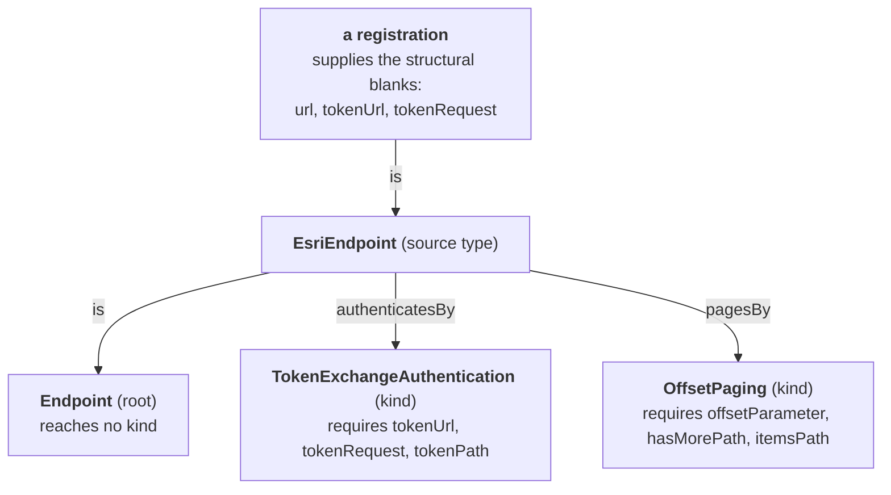

# Delta

Delta is VillageOS's **endpoint-registration service**. It has one job: it checks a registration
against the endpoint-template tree the caller's model holds, and writes it — create the Thing,
attach it to its template with an `is` relationship, and set its properties. The tree comes from the
seed the model was loaded from; Delta writes no templates.

Delta is the **write/validate** side of the endpoint story; [Tributary](TRIBUTARY.md) is the
**runtime fetch** side. Delta decides *what a valid endpoint is and writes it*; Tributary later
*resolves that endpoint's effective properties and calls it*. Neither contains per-source
(ESRI/OAuth/…) code — a source is expressed entirely as template + registration data. `SERVICES.md`
§1 lists Delta as one of the .NET services; this page is its canonical reference.

## The endpoint-template tree

Endpoints are not free-form. They are governed by a **single-rooted template hierarchy**: the root
is the Thing the model's `endpoint` role binds (the platform's templates name it `Endpoint`), and
inheritance is expressed model-natively as `is` relationships (`EsriEndpoint is Endpoint`), never a
scalar field. A registration nominates a template via its own `is` relationship (or defaults to the
root); its admissible properties are the **union of property keys along that template's chain**, and
a property's effective value is **closest-ancestor-wins**.



**A kind is a Thing an endpoint reaches, never a word it carries.** It declares the
keys it requires, so an endpoint that cannot satisfy its kind is refused before
anything is called rather than failing partway through the outbound request. The
predicates are `authenticatesBy`, `pagesBy` and `readsBodyAs`; one reaching no kind
means the plain behaviour, and the nearest declaration up the `is` chain wins.

The templates and the kinds ship in the platform's seed templates: the shared site template declares
`Endpoint` and `EsriEndpoint` with its kinds, the open-data template adds `PositionLookupEndpoint` and
`DivisionLookupEndpoint`, and the basemap template adds `EsriTileEndpoint` and `CachedTileEndpoint`.
The platform's seed validation checks the tree when a model is loaded, and holds every seeded
registration to the rule Delta applies. See [`TRIBUTARY.md`](TRIBUTARY.md) for the `EsriEndpoint`
template and the property-field taxonomy.

**The tree is read from the model on every registration.** In one subscription snapshot, Delta reads
the Thing the `endpoint` role binds and the named template beneath it, then the template's keys as
the broker resolves them up the `is` chain. Nothing is cached, so a template added to or changed in a
live model is what the next registration is checked against.

## Registration: `POST /handle` and `POST /register`

Both routes share one handler. The request body is a `RegisterEndpointRequest` — a Thing-create
shape: a `name`, a flat `properties` bag, and optional `relationships` (where an `is` row names
the template the endpoint descends from; absent → the root `Endpoint`).

```jsonc
POST /handle
{
  "name": "county-parcels",
  "properties": { "url": "https://gis.example.gov/arcgis/rest/…", "httpMethod": "GET" },
  "relationships": [ { "subject": "county-parcels", "predicate": "is", "target": "EsriEndpoint" } ]
}
```

The handler validates, then commits, in this order:

**Validate**
- `name` non-empty and `properties` present (else `400`).
- At most one `is` relationship for the subject (else `400`).
- `url` must be a non-empty, **absolute** URI (else `400`). This is checked before the model is read.
- The model must bind exactly one Thing to the `endpoint` role (`409` where it binds none or several).
- The named template (or the root, if no `is`) must be a type beneath the bound root (else `400`;
  another registration named as a template is not one), and its name must be one no other template
  beneath the root carries (else `409`).
- The model must hold exactly one `is` predicate (else `500`).
- Property keys must be a subset of the template chain's **allowed keys**, looked up through
  `EffectivePropertyResolver` as Tributary looks them up (else `400` listing the unsupported keys).
- **Effective** `httpMethod` — the request value, else the closest-ancestor template value — must be
  present and a supported method (else `400`).

**Commit (with compensation)**
- Create the endpoint Thing.
- Create its `is` relationship to the template Thing. *(Mycelium resolves `is` in-process, so
  inherited properties resolve as soon as this returns.)*
- Set each **user-supplied** property. Inherited values are **not** materialized — they resolve
  live through the `is`-chain.

If the `is`-wire or any property-set fails, Delta runs a **compensating delete** (`CompensateAsync`)
to remove the orphaned Thing, so a partial registration never lingers. Success returns the new
`registeredThingId`, `endpointTemplateId`, and `predicateId`.

## Which model a registration lives in

**A registration lives in the project's own model. There is no shared catalogue model.**

A model is the boundary of every read and every write. Mycelium binds one model per request from the
`vos:model_id` claim on the bearer, and an `/api/…` call resolves entirely inside it — nothing reads
across. Everything else follows from that:

- **Delta writes where the caller points.** `/handle` and `/register` call Mycelium back with the
  bearer that arrived, so one shared Delta registers into the model of whoever called it.
- **Tributary reads the endpoint and writes the observations under one token, in one call.** The
  endpoint Thing and the Site the readings name must therefore sit in the same model. A registration
  parked in a catalogue model could not ingest onto a project's Site at all.
- **No daemon can reach a second model.** `POST /api/auth/service-token` reads the model, service and
  scope from the caller's own claims and takes nothing from the request, so holding a token for one
  project buys no reach into another. That refusal is deliberate; a shared catalogue would need a
  cross-model authorization rule built on purpose to undo it.
- **Credentials decide it on their own.** A registration under `TokenExchangeAuthentication` carries
  `tokenRequest` — a username and password for the upstream. A catalogue every project reads is a
  catalogue in which every project reads every other project's credentials.

**Registering a common source per project is a seed entry, not repeated work.** A project is created
by seeding it. A source every project uses belongs in the seed every project is created from; a
source one project licenses stays in that project alone, with its credential. The template catalogue
a registration inherits from belongs to the project's model on the same grounds.

The templates are read from the caller's model on every registration, under the caller's bearer. A
template added to a live model is used by the next registration.

## Endpoints

| Route | Purpose |
|---|---|
| `POST /handle` | Register an endpoint (the entry point the broker calls). |
| `POST /register` | Same handler as `/handle` (direct alias). |
| `GET /health` | `{ "status": "Healthy", "service": "Delta" }`. |
| `POST /shutdown` | Graceful stop after a short delay. |

When a `VerificationKey` is supplied, `/handle`, `/register`, and `/shutdown` require a valid
Mycelium JWT addressed to Delta; `/health` stays open. Delta exposes no `/stats` endpoint.

## CLI & configuration

Delta takes the **standard launch settings** (see [`SERVICES.md`](SERVICES.md) §4):

```bash
dotnet run -- --port=<port> --myceliumUrl=<url> [--issuer=<iss>] [--audience=<aud>]
```

`--issuer` must match what Mycelium signed with and `--audience` must be Delta's own recipient
name, or `/handle` auth refuses every call. Any flag absent from the command line falls back to
configuration and the environment under its Pascal-case name — `Port`, `MyceliumUrl`, `Issuer`,
`Audience` — so Delta can be launched with no flags at all. A flag always wins over configuration.
The credentials — `Token`, `ApiKey` and `VerificationKey` — come from configuration only and are
ignored on the command line. This is the shared behaviour of every service; see
`vos.Service.Shared/Configuration/ServiceLaunchSettings.cs`.

Delta starts with no file beside it: everything it checks against is in the model.

## Source & tests

- Registration handler + lifecycle: `vos.Service.Delta/Program.cs`.
- Finding the root and the named template in a snapshot: `vos.Service.Delta/Models/EndpointTemplateTree.cs`.
- Reading the template and its resolved keys from the model: `vos.Service.Delta/Services/EndpointTemplateReader.cs`.
- Mycelium client (Thing/relationship CRUD): `vos.Service.Delta/Services/MyceliumClient.cs`.
- Key lookup shared with Tributary: `EffectivePropertyResolver` in `vos.Service.Shared`.
- Launch settings: `vos.Service.Shared/Configuration/ServiceLaunchSettings.cs` (shared).
- Tests: `Tests/vos.Service.Delta.Tests/` (`RegisterEndpointTests`, `RegistrationReadsTheModelTests`,
  `CompensateAsyncTests`), and `DeltaReadsAnEndpointTemplateTests` against the engine in
  `Tests/vos.BrokerContract.Tests/`.
