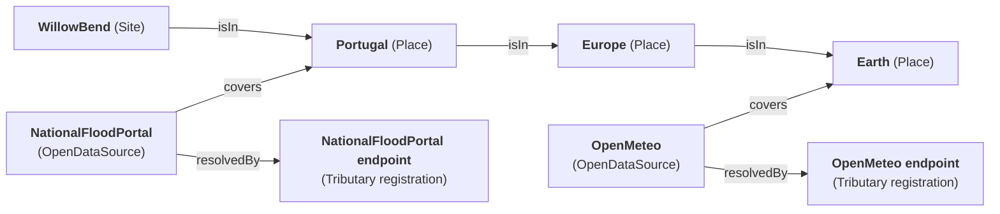

# Forage

Forage resolves a site against the outside world. Given a Site, it works out which data sources cover
that site, plans the calls to each one with the values the model holds for the call, and records what
each call came to. The calls themselves are made through Tributary by the discovery drawing that runs
Forage's steps.

It runs **before** the analysis, never inside it. Discovery populates the Site; the compute
services read what discovery wrote. That keeps the compute free of any network dependency, so
a planner adjusting an assumption sees the balances move without touching a public data portal
again.

## Coverage is relationships, not a word

A source declares where it applies by relating to a **Place** Thing, and a site relates to
the Place it sits in. Places nest, so a source covering a region covers every site within
it without naming any of them:

Both sources above cover `WillowBend`: one directly, one through the nesting.

**Where that graph comes from.** The `Place` archetype, the three predicates and the sources every
project shares are seed data: `open-data-sources.template.json` in the platform repository, read
alongside the archetype set. A registration lives in the project's own
model, so a source every project uses belongs in the seed every project is created from — see
[`DELTA.md`](DELTA.md#which-model-a-registration-lives-in). **A site's own `isIn` relationship is
written by its producer, not inherited from the archetype.** The submission producer writes one per
site, to the Place the `rootPlace` role binds through the predicate the `placeNesting` role binds —
both found through their roles, because a producer naming `Earth` would relate nothing, and say nothing, in a model that
called its root something else.

**The root is enough for a source that covers everything, and the producer claims no more.** A
submitted site is related by its producer to the root alone: `country` on a submission is optional and
stays text, it names an open set nobody can enumerate, and the vocabulary pattern used elsewhere here
*refuses* a term the model does not hold — which would turn "we have not declared your country" into
"your land cannot be submitted". A discovery run then relates the site to the finest Place carrying
the standard's code (`iso3166Code`) that the geocoder answered for its position, so a project's Place
with a division code reaches it; the typed country still relates nothing. The hazard portal covers
the root too — it is global — but its address needs an
administrative division code (`hazardPortalDivision`), which a project can put on a Place its sites are
related into and which a run otherwise works out for itself from the site's position — see
[Resolving the hazard division](#resolving-the-hazard-division). A site that reaches no such Place and
whose division could not be resolved has the portal's calls refused before the provider is contacted
and reported with the unfilled placeholder named, so the gap in the model is reported, where leaving
the source out would make the report look complete.

**Why not a `coverage` string.** The failure this path exists to prevent is a source that
does cover the site being silently skipped because a country was written two ways —
`Portugal` against `PT`, or a difference in case. Matching strings is what causes that;
walking relationships makes it impossible rather than merely reported. Adding a country becomes a
model edit with no deployment, and a reader can ask what else is true of a Place. This is
the repository's *things and relations, not strings* rule applied to the one place where
getting it wrong is invisible: a source that is never selected cannot appear in the
unresolved list either, because nothing knew to look for it.

## The predicates it reads

| Predicate | Reads | Why |
|---|---|---|
| `isIn` | `Site isIn Place`, `Place isIn Place` | Where the site is, and what contains that. Walked to any depth, so nesting can be as deep as a model wants — upwards from a site, and downwards from the Places a source covers when a source is being offered. |
| `covers` | `OpenDataSource covers Place` | Where a source applies. Several `covers` relationships are fine; the source is still selected once. |
| `resolvedBy` | `OpenDataSource resolvedBy Endpoint` | Which Tributary registration a call goes through. A relation, not a copied name, so renaming the registration cannot strand the source. |
| `resolvesOnto` | `OpenDataSource resolvesOnto archetype` | What a source's readings are about, where that is not the site itself. A source naming an archetype is called once per Thing the site `has` of it, with that Thing as the call's subject — the hazard portal grades one assessment per call, and the soil source reads one soil horizon per call. |
| `studies` | `SiteStudy studies Site` | The site's study, which Mark discovered hands on. Read incoming, because the relationship runs from the study to the site. |
| `has`, `is` | `Site has HazardAssessment`, `Site has SoilHorizon`, `Site is Site` | The Things a per-subject source is called about — and whether a Thing is a site, by whether what it `is` is the archetype the `site` role binds. |
| `assesses` | `HazardAssessment assesses HazardType`, `SoilHorizon assesses SoilDepth` | What an assessment or a horizon is about. The Thing it reaches carries the provider's code for it — the hazard code, or the depth label — and a per-subject call is addressed with what its subject reaches. A further per-subject source whose vocabulary hangs off a different predicate adds that predicate here. |

An `OpenDataSource` with no `resolvedBy` relationship is **left out** rather than reported as a failure.
It is not a source that failed — it was never callable, and listing it as unresolved would
blame a provider for a gap in the model. A site with no study, or with several, fails Mark discovered
and stays awaiting discovery, because which study its analyses read is not clear.

## Reading the model

One scoped snapshot answers each question. **A site's read** answers everything about it: the site's
Places, then every source whose coverage reaches one of them, then those sources' registrations — and,
model-wide, the two division lookups, which no relationship reaches because neither covers a Place, and
every Place, asked for through the `placeArchetype` role, so the run can relate the site to the one
carrying the code the geocoder answers. Traverse rules compose over the set built so
far, so the walk must ask for `isIn` **first** — asking for the incoming `covers` relationships before the
Places are in the set finds nothing. Tributary's read of an endpoint's kinds has to keep its rules in
order for the same reason; see [`TRIBUTARY.md`](TRIBUTARY.md). A site's read carries only the relationships the selected Things
hold outgoing, in one rule naming no predicate, so the `isIn` every other site writes into a shared
Place does not travel with it. **A source's read** is the same walk from the other end, naming its
predicates one by one: the Places it `covers`, then `isIn` walked *downwards* through their nesting, then
what each site there `has` — see [A source added to the catalogue](#a-source-added-to-the-catalogue).

A failed read writes nothing, never an empty answer. An unreachable gateway must not read as
"no source covers this site" — the two answers look identical to a caller and only one of
them is true — nor as a source that reaches no site, which would then be stamped as offered to all
of them. The step fails, and the box may try it again.

## What starts a run

**A site entering a state, not a call.** The model declares a range on the `Site` archetype,
`SiteAwaitingDiscovery` — coordinates known, and either the site's coverage never matched or some
coverage of it still outstanding — and a connection bound to the orchestrator watches it. A site
entering that state makes the platform write a durable call record from the site to the connection and
call the orchestrator, which runs the **Site discovery** drawing with the site as its subject. Nothing
in either repository calls Forage directly: **what started a run is a fact in the model afterwards**,
which a call over HTTP would have left only in a log. The call finishes when the orchestrator reports
that the run ended.

| | How it happens |
|---|---|
| A run starts | A site's coordinates are written and its coverage has never been matched |
| A run does not start again | Record results records each call's answer on that call's own coverage and Mark discovered stamps `coverageMatchedAt` on the site; once no coverage is outstanding the site leaves the state on its own |
| A run in which a source failed | Leaves that source's coverage outstanding, so the site stays in the state; the connection calls again within its call-again limits, and the next run plans only that source's calls |
| A run whose model read failed | Fails the step, which its box may try again; a run that still fails writes nothing and stamps nothing, so the site stays in the state |
| A source added to the catalogue later | Starts a run of the **Source offer** drawing, from its own state, which offers it to every site under the Places it covers: a coverage minted per call those sites would make, nothing fetched. One outstanding coverage puts each site back in the state, and that site's next run plans only this source — see [A source added to the catalogue](#a-source-added-to-the-catalogue) |
| A surveyed site | Enters the same state and is discovered the same way; nothing here is particular to a submission |

**A source has a state of its own.** `SourceAwaitingSites` on the `OpenDataSource` archetype — its
`coverageMatchedAt` unknown — is what starts a source's offer, and a source declared in a template is in
it the moment the seed loads, so the sites already in the model are offered it without anything calling
anything. Offer a source stamps the source when it has reached every site, which is what takes it out.

The ranges are declared beside the `Site` and `OpenDataSource` archetypes in
`land-intake.template.json` in the platform repository; the connections and the two drawings beside the
sources in `open-data-sources.template.json`. A deployment that never fetches reads neither file and
runs no discovery service.

## The discovery drawing

The Site discovery drawing is a box for each step, in this order:

1. **Resolve region** (Forage) works out the site's administrative division where the model supplies
   none — see [Resolving the hazard division](#resolving-the-hazard-division) — and hands on the
   address the calls are made with.
2. **Plan calls** (Forage) finds the sources covering the site, mints a coverage for each call the
   model records none for, and hands on one item per outstanding call, or one per slice of a long
   history.
3. **Fetch each call** (Tributary's fetch step) makes the planned calls one at a time. A call that
   fails leaves on the fail wire and the others go on.
4. **Judge history** (Tributary's `historyChanged` step) has each subject the fetches wrote onto judged
   again, so the derived values reading its series are worked out again.
5. **Record results** (Forage) writes what each call came to onto its coverage.
6. **Resolve words** (Forage) turns the fetched words into the relationships the model declares.
7. **Mark discovered** (Forage) stamps the site and hands on its study.

The Source offer drawing has one Forage box, **Offer a source**.

## What a run records, and what it therefore skips

**Every call a run makes has a `SourceCoverage` to record what it came to** — one Thing per subject and
source, declared by the platform and filled here. It carries `resolvedAt` when the answer
landed, and `lastAttemptAt`, `attempts` and `failureReason` when it did not. Plan calls mints one for any
call the model has none for, relating it `appliesTo` the subject and `sourcedFrom` the source. The
record's identifier is worked out from the subject and the source, and the record and its relationships
go in one `/api/model/fragment` write, so writing it twice changes nothing.

**A call whose coverage already carries `resolvedAt` is not planned again.** That is the point of the
Things: a source answering for one subject and failing for another leaves exactly the second outstanding,
and a run over the same site afterwards plans only that one. A source every one of whose calls has been
answered drops out of the run entirely rather than being called with nothing to fetch. Each value the
broker refuses to write onto a coverage is written once more, because a coverage missing its
`resolvedAt` reads as a source never asked; a value refused twice is given up on and logged with the
coverage it was meant for, and the call stays outstanding as any unanswered one does.

**The subject, not the site.** A source that `resolvesOnto` an archetype is called once per Thing the
site has of it, so its coverage of one assessment is a different Thing from its coverage of another. A
portal answering for five of a site's assessments and not the sixth records five resolved and one
outstanding; per source, the sixth would either be lost or re-call all six.

**This is where a run's report lives.** On the coverages it is durable and per call, and a planner
reaches it from the gap it explains; a log line is read by nobody the gap matters to. `attempts` is
added to rather than overwritten, so a provider that has failed every run since the site was submitted
reads differently from one that failed once.

`coverageMatchedAt` is stamped on the site whatever the run found, including nothing: a site no source
covers has been looked at, and saying so is what tells it apart from one still waiting to be.

**A model that declares no coverage vocabulary still fetches.** It records nothing and plans every call
again next time, because discovering nothing at all would be worse than fetching what was already
fetched; Plan calls logs an error saying so. The archetype is found through the `sourceCoverage` role,
never by name.

## A source added to the catalogue

**Offering a source is a site's discovery in reverse, and it mints and fetches nothing.**
A site's read walks from the site up through its Places to the sources covering them; Offer a source
walks from the source through the Places it `covers` and *down* their nesting to every site in them.
Places and sites arrive by the same walk, and the `site` role's binding is what tells them apart — the
`proposes` relationship could not, because it reaches a submitted site only and a surveyed site has no
such relationship.

**One coverage per call those sites would make.** The step works out, for each site it reaches, the
calls the source would be asked — one about the site, or one per Thing the site has of what the source
`resolvesOnto` — and mints a coverage for every call the model records none for, relating it
`appliesTo` the subject and `sourcedFrom` the source, exactly as the site's run would. A call already
recorded, answered or not, is left alone: a second coverage would let a site be judged against one and
recorded on the other. A site in a Place the source does not cover is not offered it, however many other
sources cover that Place.

**Nothing is fetched here.** A minted coverage is outstanding, and that is what puts each site back in
`SiteAwaitingDiscovery`; the run that fetches is the site's own, and it plans only this source. Running
the fetches from the source's side would call every site's providers from one step, outside the
one-call-at-a-time fetch a site's run holds to.

**`coverageMatchedAt` is stamped on the source when the step has reached every site**, including a
source with no registration — offered to nothing, because nothing can call it — so it leaves
`SourceAwaitingSites` rather than starting an offer again on every load. A step whose read failed stamps
nothing and mints nothing: stamped, the source would read as offered to every site it covers while
having reached none, and nothing would offer it again. A model declaring no coverage vocabulary has
nothing to mint, so the step fails, saying so, and writes nothing.

## Planning the calls

**Partial failure is normal and is tolerated.** Public data portals go down, and an intake that
aborted because one provider was unavailable would be abandoned. A source that fails leaves its
value undiscovered, does not stop the others, and appears in Record results' `unresolved` with a
reason — carrying the provider's own words where there are any, because that is the most useful thing
a planner can be told about why a value is missing. Reporting what did *not* resolve matters as much as
reporting what did: a list with sources missing and nothing said about them reads as a complete one.

**A call is addressed from its subject outward.** Whatever the call's subject carries — coordinates,
elevation, climate zone — is passed as its address parameters, and behind it, layered so the most
specific holder of a name decides it: the subject's own values first, then (for a per-subject call)
the values of the Things it reaches by its own outgoing relationships, then the site's, then each Place the
site is in, nearest first. A source's address takes only the placeholders it names and the fetcher
ignores the rest, so one set of values serves a source wanting coordinates, one wanting a division
code, and one wanting neither, with no per-source arrangement here. Inherited values are left out — a
value from an archetype is a default for a *kind* of site, and calling a provider with a default
location would return a confident reading about somewhere else — and so are the double-underscored
marks readers find Things by, and any name that Things standing at the same distance disagree on,
because relationship order is undefined and taking either would address different calls on different
runs.

**Then from the source itself.** Beneath everything the subject supplies, the source's own values fill
placeholders by name, so a registration declaring `granularity` addresses `{granularity}`; a source
declaring `historyYears` is given `{startDate}` and `{endDate}`, a window of that many years ending
today — in the wall clock's date, because an archive holds the years that actually happened whatever
time the model is anchored to; and a source reaching Things along the predicate the
`providedVariable` role binds is given `{variables}`, each Thing's `providerName` joined with commas
in the Things' name order, so two runs address one call the same way. A name the subject and the
source both carry takes the subject's. That is how a climate history source's reach, granularity and
variables live on the model: a deployment edits the registration or adds a variable Thing, and the
next call carries it.

**A source that declares what it resolves onto is called once per Thing, not once per site.** The
hazard portal grades one assessment per call: its `resolvesOnto` relationship names the `HazardAssessment`
archetype, so a run calls it once for each assessment the site `has`, with that assessment as the
call's subject — the reading lands on the assessment it grades, and the division and hazard codes
arrive from the Place and from the type Thing the assessment `assesses`. The soil source is called the
same way, once per `SoilHorizon` the site has, addressed with the depth label the horizon reaches along
`assesses`. A declared source on a site holding nothing of its archetype has nothing to fetch: that is
logged and is not a failure. A failed per-subject call names its subject, because a portal answering
for five assessments and not the sixth must not read as a source that failed outright.

**A source reaching back years is asked for a slice of that reach at a time.** Plan calls cuts the
window into slices of `ForageLaunchSettings.SourceWindowDays` days, or of the number of days the source
states in `daysPerSlice`; a stated value that is not a whole number of days of at least 1 fails the
plan, naming the source. The reach is the model's to declare and a long one is legitimate; what one
call can carry is a fact about the deployment. A whole reach in one call makes the provider's answer,
the reshape that follows it and the write it becomes each as large as the reach — at a decade of
hourly readings, millions of readings in each, which exhausts the fetching service while it reshapes
and is refused as a single write.

**The fetch box asks the slices one at a time** and tries a failed slice again as its `attempts`,
`pauseMinutes` and `pauseGrowth` settings say; a refusal that cannot change fails the slice at once.
One call at a time also means a site covered by many sources, or a source called once per assessment,
cannot open a burst of connections that reads as abuse. Record results counts a call resolved only
when every one of its slices answered, so a slice that failed every attempt leaves the whole call
outstanding for the next run.

**Fetching is not done here.** The fetch box hands each planned call to Tributary, which resolves the
registration, fills the address placeholders, reshapes the response and writes the observation onto
the call's subject. **Each planned call names its subject** — the site, or the Thing a per-subject
source is called about — so the reading lands on the Thing the call is for rather than on whatever
entity the shared registration's expression names — see
[`TRIBUTARY.md`](TRIBUTARY.md#naming-the-subject-a-call-is-about).

**Every source that resolved stays reachable from the site.** The fetch relates the registration to
the site through `observed`, so a value on the site leads back to the registration and from there to
the `OpenDataSource` along the `resolvedBy` relationship this service already reads. Nothing here
writes that relationship; it is the ingest's, and it is written once per registration per site however
often discovery runs — see [`TRIBUTARY.md`](TRIBUTARY.md#which-registration-wrote-a-value). A source
that did not resolve never reaches the ingest, so it leaves no relationship suggesting it did.

## Resolving the hazard division

**Before the fetches, Resolve region works out which administrative division the site stands in.** Every
route the hazard portal serves takes a division code and none takes coordinates, so a site whose model
supplies no code has every grading refused before the provider is contacted — which reaches a planner as
an empty hazards table and reads as "no hazards here".

**It is a step in the run because nothing else can see the site's country.** The portal's own search
takes a *name*, and answers every division of that name in every country: `Santarem` answers one in
Portugal and two in Brazil. A reshape expression sees only the provider's reply, and the provider takes
no country to filter by, so the choosing has to happen where the site's values are known.

Five rules, each of which a wrong answer would break:

- **A model that supplies a code decides.** The site's own value and its Places' are already layered
  into the call's address, so the step resolves only where neither supplies one. A project that coded its
  own Place keeps it, and a site that needs no lookup costs two providers nothing on every run.
- **A Place carrying the geocoder's code comes before the search.** A Place carrying a code the
  geocoder answered for the position (`ISO3166-2-lvl<n>`, then `country_code`) is related to the site,
  and its own division, where it carries one, addresses the gradings. Two Places carrying one code are
  neither taken, and a refused relationship leaves the search to grade the site.
- **English is asked for the country, and the local names beside it.** Left to a geocoder's default a
  Dutch site answers `Nederland`, which the portal matches to nothing, so the address the model holds
  asks for English. Where the `localAreaNameLookup` role binds a registration the same call is made
  with no language, for the names the portal holds a
  division under; a refused local call leaves the English names to be searched.
- **Only the site's own country counts**, and the two providers do not agree on a country's full name —
  the geocoder says `United States` where the portal holds `United States of America` — so they are
  matched by one name starting with the other rather than by equality.
- **The finest division of those left is taken, among the divisions named exactly what was searched**,
  with accents folded away — the geocoder writes `Santarém` even in English and the portal holds
  `Santarem` — because the portal's search answers every division whose name contains the text:
  `mazowieckie` answers Wysokie Mazowieckie in another voivodeship, deeper than Mazowieckie. The same
  name exists as a region and as the district inside it, graded differently: Portugal / Santarem reads high river flood as the region and medium as
  the district. The district is the land the site is actually in. Two divisions standing equally deep
  are a tie nothing here can settle, so neither is taken — a guessed division reads exactly like a
  resolved one, and telling a landowner their land does not flood is the failure this whole path exists
  to prevent.

**The portal is searched per level, finest first, by the English name, the local name, then each word
of four letters or more of either, local words first, each name once; the state is searched when the
county finds nothing.** A geocoder answering `Dukes County` where the portal holds `Dukes` reaches the
division by its word, and a county the portal holds under no name at all falls to the state the geocoder
also gave, which the portal does hold — so the site is graded at the coarser division rather than not
at all. A search that was *refused* is not a name the portal holds nothing for: the step
stops there rather than asking a coarser question, or one provider's outage would become a coarser
grading nobody chose.

**What it settled on is written onto the site and addresses this run's own calls.** The code first,
because that is what addresses a grading; a name written beside a code that would not go would read on
the page as a division the gradings never came from. Resolve region hands the division on in its
`address`, which Plan calls addresses the calls with, so a site is graded on the run that resolved its
division rather than on the next one.

**Both lookups go through the fetching service**, at addresses the model holds — the registrations are
the ones the `areaNameLookup` and `hazardDivisionLookup` roles bind (with `localAreaNameLookup` beside
the first). Forage makes them itself, through Mycelium, to the endpoint service named by
`OutsideCalls.FetcherSubdomain`. They carry no reshape expression, so the provider's own body comes back
and nothing is written from it (see [`TRIBUTARY.md`](TRIBUTARY.md#fetch-and-shape-not-derive--the-metabolism-boundary)).
Neither is an `OpenDataSource`, neither covers a Place, and neither has a coverage: nothing they answer
is a reading about the site. A step that resolves nothing writes nothing, so the gradings stay
outstanding, the site stays in the state that started the run, and the next run tries again.

**A lookup is bounded twice.** A provider that accepts the connection and then goes quiet is ended by
Mycelium's limit on the request it passes on. `ForageLaunchSettings.SourceTimeout` ends a lookup the
broker never answers at all, so it must be longer than `--passedOnRequestLimitSeconds`. When it is not,
Forage logs one warning at start-up naming both numbers, and starts as usual.

## Resolving the fetched words

**A fetched word becomes the relationship the model declares, inside the run that fetched it.** Some
vocabularies take their word from a fetch — a site's climate class, an assessment's hazard grade —
and a fetch writes property values, never relationships. So after the fetches, Resolve words resolves
each written word against the vocabulary the model declares and relates the subject to the member it
names.

**Everything is read from the declaration**: the vocabulary archetype
`is` the kind the `discoveredVocabulary` role binds and names, in `resolvedFromProperty`, the property its
word arrives under; an archetype-level relationship — `Site classifiedAs ClimateZone`,
`HazardAssessment gradedAs HazardLevel` — names the Thing the word is written onto and the predicate
the resolved relationship is written through. Nothing here names a vocabulary, an archetype, a predicate or a
property of any model, so a project adding a vocabulary edits its model and deploys nothing.

**That relationship has to stay the only one from a subject to its vocabulary.** It is how a run learns which
predicate its own resolution writes through, so a second would leave it unable to tell which was its —
and it could write somebody else's. A vocabulary the submission producer resolves is therefore found
through a role and declares no relationship, which is why `reportedAs` sits beside `gradedAs` as the
predicate the `reportedLevel` role binds, and carries nothing. What a submitter reports and what a portal grades are two
predicates to the same Things, and only one of them is a discovery run's.

**The words come from the fetch answers, not from reading the model back.** An observation is
accepted into a queue and applied by the drainer after the write returns, so a read straight after
the call races it; the fetching service reports what each subject call wrote (`written`, see
[`TRIBUTARY.md`](TRIBUTARY.md)), Record results passes that on, and that is what is resolved.

**A changed word moves the relationship.** A relationship already pointing at the named member is left
alone; one pointing elsewhere is removed in the same write as its replacement, so a re-graded
assessment never carries two levels, and a removal another run already made counts as done.

**A word the vocabulary does not hold writes no relationship and is reported** in `unknownWords`,
naming the source, the subject, the property, the word and the vocabulary. Writing it would invent a
member the scheme does not hold; refusing the fetch would turn a provider's odd answer into an outage.
The word stays on the subject's series as the record of what the source answered — for these
vocabularies the series is the provenance and the relationship is the conclusion, so the word is kept
beside the relationship. A word that matches a member only up to case, and a member name two Things
carry, are reported the same way rather than guessed at.

**A relationship the platform will not write** is handled by what it answered:

- **403** is refused for good. The word is reported in `refusedWords`, with the subject and the
  platform's reason, and logged as a warning, and the step succeeds.
- **400** makes Forage read the vocabulary again. Where the same relationship is still the one to write,
  the step fails at once with the platform's words. Where the member has changed, the write lost a race,
  and the step fails so it may be tried again. Where the member is gone, the word moves to
  `unknownWords`.
- **Any other failure** fails the step so it may be tried again.

**A failed declaration read fails the step so it may be tried again.** Mark discovered runs only on
Resolve words' success, so the site stays awaiting discovery until a run resolves its words.

## Marking a site discovered

**Mark discovered stamps `coverageMatchedAt` on the site and hands on the site and its study.** It takes
the site from the run's subject. Its only wire is from Resolve words' success, and it never reads what
that wire carries: the wire is what keeps it from running, and the site from being stamped, when Resolve
words fails.

**The study is read before the stamp.** A site with no study that `studies` it, or with several, fails
the step and is left awaiting discovery, because which study its analyses read is not clear.

**Forage starts no analysis.** What reads the study next is the drawing's to say.

## Answering as pipeline steps

Forage answers only step requests on `/handle`, so each step can be a box on a pipeline canvas. A
relationship call is refused with `400`. The step service's `callParameters` choose the step, and
each of Forage's step services holds its own, such as `{"step":"planCalls"}`. `GET /manifest/{step}`
declares each step's ports and offers a box no step setting:

| Step | Takes | Gives |
| --- | --- | --- |
| `resolveRegion` | `site` | `address` |
| `planCalls` | `site`, `address` | `calls`, one per slice of a long history |
| `recordResults` | `resolved`, `unresolved`, `judged` (never read; it holds the box back until every subject's history is judged) | `resolved`, `unresolved` |
| `resolveWords` | `resolved` | `written`, `unknownWords`, `refusedWords` |
| `markDiscovered` | `site`, `written` (never read; wired from Resolve words' success) | `site`, `study`; it stamps `coverageMatchedAt` |
| `offerSource` | `source` | `outstanding` |

A step takes a Thing as its id, or as an object naming it by `id`. A failed read of the model is a
failure the orchestrator may try again.

## Pointers

- [`TRIBUTARY.md`](TRIBUTARY.md) — the fetcher the discovery drawing calls, its per-call address
  parameters, and how a reshape expression turns a response into an observation on the Site.
- [`LAND_INTAKE.md`](LAND_INTAKE.md) — the land intake this serves, and the model the
  Site, Parcel and OpenDataSource archetypes sit in.
